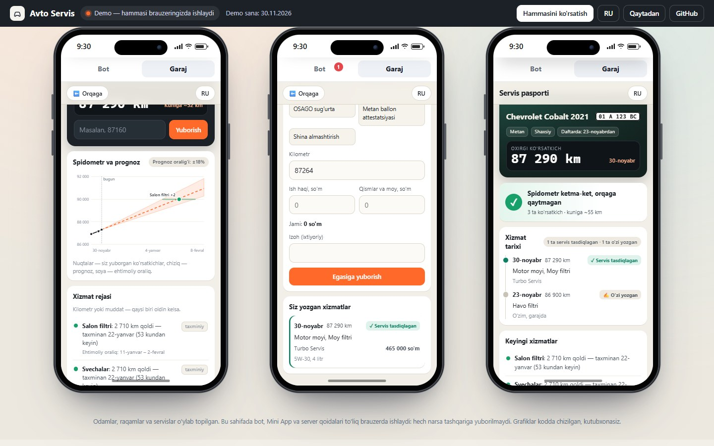
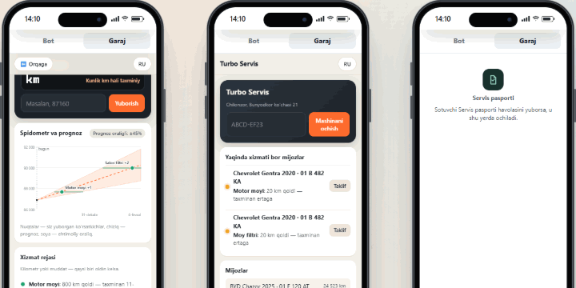
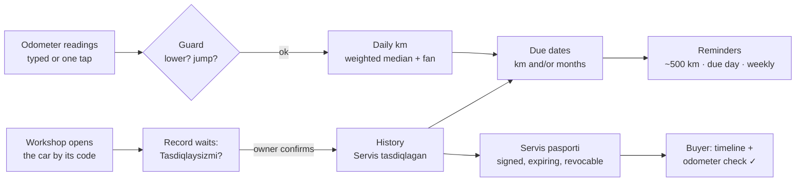

# Avto Servis

**English** · [O'zbekcha](README.uz.md)

[](https://github.com/xoliddev/avto-servis/actions/workflows/ci.yml)
[](https://xoliddev.github.io/avto-servis/)
[](LICENSE)


A car's **service book for Uzbekistan**: a Telegram bot (everything works from buttons) plus a Mini App, "Garaj", for
history and charts. Cobalt, Gentra, Nexia 3, Spark, Damas, Malibu, Tracker, Onix, BYD Chazor… on benzin, metan,
propan, hybrid or electric; several cars per owner.

**The wow moment — the next service, forecast from mileage.** The owner sends the odometer now and then (type the
number, or one tap on today's estimate from a reminder). The bot measures how many km the car really drives a day and
answers: *"Motor moyi: 540 km qoldi — taxminan 9-dekabr (11 kundan keyin)"*. The Mini App draws the odometer: real
readings, a forecast line with an **uncertainty fan** that tightens as readings come in, and markers where each service
falls due. A workshop records the oil change, the owner confirms it, and the record carries a **"Servis tasdiqlagan"**
badge. When the car is sold, a **Servis pasporti** link shows the buyer the verified timeline and that the odometer
never went back.

**[Live demo →](https://xoliddev.github.io/avto-servis/)** three phones side by side (the driver, the workshop master,
the buyer), a simulated bot and the real Mini App code. Everything runs in your browser.



<p align="center"></p>

## Features

- **Cars.** Uzbek-market models, year, fuel (benzin / metan / propan / gibrid / elektr), personal or taxi use, plate
  (`01 A 123 BC` or `01 123 ABC`), odometer and, optionally, the km of the last oil change.
- **The service plan.** Items with intervals by km **and/or** months, whichever comes first, adjusted by fuel and use:
  motor oil 8 000 km or 6 months (6 800 on metan, 5 400 for a metan taxi), oil, air and cabin filters, brake pads,
  spark plugs (60 % on metan), antifreeze, the timing belt (only models with a belt), a yearly battery check, winter /
  summer tyres in season, and the documents: **texnik ko'rik**, **OSAGO** and the **metan ballon attestatsiyasi**.
  Data lives in `shared/data/plan.json`; every item can get its own interval or be taken off the plan, per car.
- **Forecast.** Daily km is a *weighted median* of the rates between readings (recent intervals weigh more, a long gap
  counts at most 30 days), in whole metres per day so Python and JavaScript agree exactly. The fan is the weighted
  20th–80th percentile, never narrower than a margin that shrinks with the number of readings (±45 % with one reading,
  ±36 % with two…). Each item gets km left, the expected day and its likely range.
- **Reminders, exactly once.** "~500 km or 7 days left", once on the due day, then a gentle weekly nudge while overdue,
  and a request for a reading after 14 days without one. Each reminder key is claimed in SQLite (`INSERT OR IGNORE`)
  before it is sent, so restarts never repeat one. Quiet from 21:00 to 09:00.
- **Odometer guard.** A reading lower than the last is refused ("Spidometr orqaga ketmaydi"); more than 1 500 km a
  day since the last reading asks to confirm; a past service record must fit between the readings around it.
- **History and spending.** Records with date, km, items, labour and parts in whole so'm, workshop, receipt photo
  (Telegram file id) and a note. After a record the affected items start a new cycle. Spending per month, per item
  (a record's cost shared evenly between its items) and **so'm per km**; CSV export with formulas neutralised.
- **Workshops.** A workshop opens a car only by the code the owner gave (typed, or the `start=c_<code>` deep link),
  records the service, and the owner gets **"Tasdiqlaysizmi?"**: only after "Tasdiqlayman" does it count, with the
  "Servis tasdiqlagan" badge (self-logged records say "O'zi yozgan"). A workshop sees its clients whose service is due
  soon — only owners who allowed it — and can send one invitation per due item. New workshops join with a one-time link.
- **Servis pasporti.** A read-only link (7, 30 or 90 days, revocable) for a used-car buyer: the car, the timeline with
  verified vs self-logged records, the odometer check ("spidometr ketma-ket, orqaga qaytmagan" ✓), and the next due
  items. No money, and no owner name or phone unless the owner ticks it. It opens in any browser or in the bot.
- **Buttons only.** `/start` (with its deep links) is the only command; every screen has "⬅️ Orqaga". Uzbek by
  default, Russian with one tap — in the bot and in the Mini App.

All people, plates and workshops are **fictional**; seeded people have negative ids (Telegram user ids are always
positive), so nobody can sign in as them. Seeds are relative to "today" and tested over 30 days and across New Year.

## How it works



The rules live in a pure core (`avtoservis/core/`, whole numbers only) with a line-by-line JavaScript port
(`shared/*.js`) for the Mini App and the demo. `scripts/make_vectors.py` writes `shared/test_vectors.json` from the
Python core — forecasts, plan statuses, reminder keys, passport tokens, the seeded world and even the sentence
"Motor moyi: … km qoldi" in both languages — and `node --test` checks the JS port against it, so a number shown in the
bot, the Mini App and the passport is always the same number.

| Part | Where |
|---|---|
| Pure core: calendar, cars, forecast, plan, odometer, records, stats, reminders, tokens, seed | `avtoservis/core/`, `shared/*.js` |
| Service: garage, history, workshops, passport, reminders (SQLite, WAL, `BEGIN IMMEDIATE`) | `avtoservis/*.py` |
| Bot (aiogram 3, buttons only) | `avtoservis/bot/` |
| Mini App "Garaj" + its API (aiohttp) | `webapp/`, `avtoservis/web*.py` |
| Browser demo (in-page backend, simulated bot) | `demo/` |

## Security

- **Mini App auth:** every API call carries Telegram `initData`; its HMAC is checked in constant time and `auth_date`
  must be fresh (default 1 hour, a little clock skew allowed). The user id always comes from it.
- **Who sees what:** owners see only their own cars (anyone else's id answers "not_found"); workshops only cars whose
  code they were given and only the records they made; invitations only to owners who allowed them, once per item.
- **Servis pasporti links:** 12 random bytes + an HMAC-SHA256 tag, checked before the database is asked; expiry and
  revocation in the database; forged, revoked and expired links all answer the same; the public call takes the token
  in the body (never in the URL) and is rate-limited per address. Car codes are 40 random bits; wrong codes are
  rate-limited per workshop.
- **Input:** strict validation (odometer 0–2 000 000, dates within ten years, money up to 50 000 000 so'm per field,
  lengths, plate formats, plan items from the car's own plan), parameterised SQL, callback data matched by strict
  regexes and re-checked against the caller, 16 KB body cap, per-user rate limits.
- **Output:** user text is escaped in bot messages and only ever set as `textContent` in the Mini App; a strict CSP;
  the CSV export neutralises formulas.
- **Ops:** non-root, read-only container; no secrets in the repo (`.env` is ignored, `.env.example` has placeholders).

## Run it

```bash
cp .env.example .env          # put your BOT_TOKEN from @BotFather in .env
pip install -r requirements.txt
python -m avtoservis
```

The Mini App needs a public HTTPS address (`PUBLIC_URL`, for example a free cloudflared tunnel); without it the bot
works on its own and passport links open in the bot. With Docker:

```bash
docker compose up -d --build
```

Development:

```bash
pip install -r requirements-dev.txt
ruff check . && pytest                       # core, service, passport, bot (mocked Telegram), HTTP
node --test js-tests/*.test.mjs              # JS port parity + the demo story headless
npm i --no-save playwright && node scripts/e2e.mjs   # the demo in Chromium at 1440 and 375 px
python scripts/make_vectors.py               # after changing the Python core
```

## Tests

- **pytest (31):** the core and its vectors, the whole story on the service (forecast, the reminder once, the
  workshop record waiting for the owner, the forecast reset), the odometer guard, isolation between owners and
  workshops, invitations, documents and own intervals, reminders across a restart and at night, joining links, the
  passport (no money, no owner, forged / revoked / expired), the real aiogram handlers against a mocked Bot API, HTTP
  (auth, isolation, the public passport call, limits, CSP).
- **node --test (14):** the JS port against the Python vectors; the demo story on 30 consecutive days, across New
  Year, morning and night, in order and out of order.
- **Playwright (47 checks):** the demo at 1440 px and 375 px with zero console errors.

## Docs

- [CHANGELOG.md](CHANGELOG.md)
- Media: [thumbnail](docs/media/thumb.jpg), [desktop](docs/media/demo-desktop.jpg), [phone](docs/media/demo-mobile.jpg)

MIT © xoliddev
