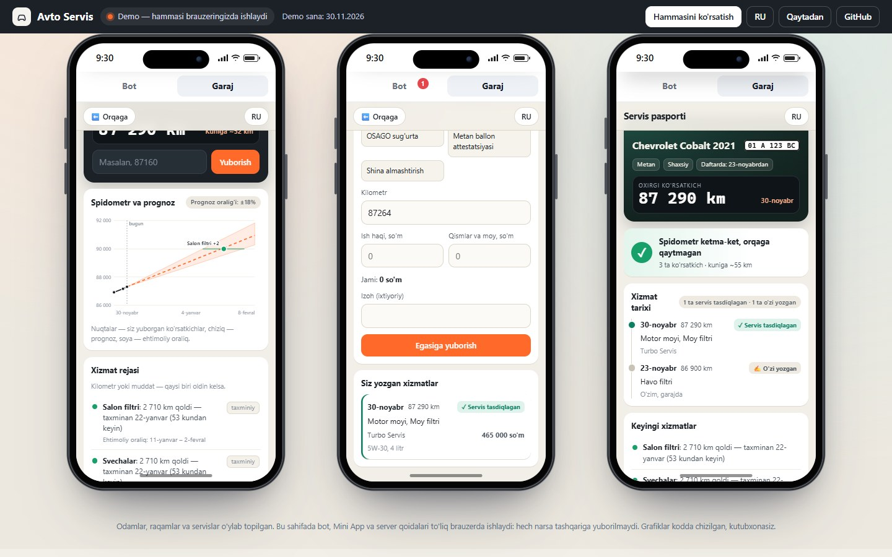

# Avto Servis

[English](README.md) · **O'zbekcha**

[](https://github.com/xoliddev/avto-servis/actions/workflows/ci.yml)
[](https://xoliddev.github.io/avto-servis/)
[](LICENSE)

Mashinangizning **xizmat daftari**: Telegram bot (hammasi tugmalar bilan ishlaydi) va tarix hamda grafiklar uchun
"Garaj" Mini App. Cobalt, Gentra, Nexia 3, Spark, Damas, Malibu, Tracker, Onix, BYD Chazor… benzin, metan, propan,
gibrid yoki elektr. Bitta egada bir nechta mashina bo'lishi mumkin.

**Asosiy narsa — keyingi xizmat kilometrdan oldindan.** Egasi vaqti-vaqti bilan spidometrni yuboradi (raqamni yozadi
yoki eslatmadagi taxminiy raqamni bitta bosish bilan tasdiqlaydi). Bot mashina kuniga haqiqatda necha km yurishini
hisoblaydi va aytadi: *"Motor moyi: 540 km qoldi — taxminan 9-dekabr (11 kundan keyin)"*. Mini App spidometr grafigini
chizadi: yuborilgan ko'rsatkichlar, prognoz chizig'i va **ehtimoliy oraliq** (ko'rsatkich ko'paygan sari torayadi),
har bir xizmat vaqti belgisi bilan. Servis moyni almashtirib yozadi, egasi tasdiqlaydi — yozuvda **"Servis
tasdiqlagan"** belgisi turadi. Mashina sotilganda **Servis pasporti** havolasi xaridorga tasdiqlangan tarixni va
spidometr hech qachon orqaga qaytmaganini ko'rsatadi.

**[Jonli demo →](https://xoliddev.github.io/avto-servis/)** uchta telefon yonma-yon: haydovchi, servis ustasi va
xaridor. Hammasi brauzeringizda ishlaydi.



## Nimalar bor

- **Mashinalar:** model, yil, yoqilg'i, shaxsiy yoki taksi, davlat raqami (`01 A 123 BC`), spidometr va xohlasa oxirgi
  moy almashtirilgan kilometr.
- **Xizmat rejasi:** kilometr **yoki** oy — qaysi biri oldin kelsa. Motor moyi 8 000 km yoki 6 oy (metanda 6 800,
  metanli taksida 5 400), filtrlar, kolodkalar, svechalar, antifriz, GRM remni (remenli modellarda), akkumulyator,
  qishki/yozgi shina, hujjatlar: **texnik ko'rik**, **OSAGO**, **metan ballon attestatsiyasi**. Har bir mashinada
  intervalni o'zgartirish yoki xizmatni rejadan olib tashlash mumkin.
- **Prognoz:** kunlik kilometr ko'rsatkichlar orasidagi tezliklarning *vaznli medianasi* (yangilari og'irroq). Bitta
  uzoq safar prognozni buzmaydi. Har bir xizmat uchun: necha km qoldi, taxminiy kun va ehtimoliy oraliq.
- **Eslatmalar faqat bir marta:** ~500 km yoki 7 kun qolganda, muddati kelgan kuni, keyin muddati o'tgan bo'lsa
  haftada bir marta; 14 kun kilometr kelmasa — so'raydi. Server qayta ishga tushsa ham takrorlanmaydi. 21:00 dan
  09:00 gacha jim turadi.
- **Spidometr himoyasi:** oxirgisidan kam raqam qabul qilinmaydi ("Spidometr orqaga ketmaydi"), kuniga 1 500 km dan
  ortiq sakrash tasdiq so'raydi.
- **Tarix va xarajatlar:** sana, km, xizmatlar, ish haqi va qismlar (so'mda, butun son), servis, chek rasmi, izoh.
  Oy bo'yicha, xizmat bo'yicha va **1 km uchun so'm**; CSV fayl.
- **Servislar:** servis mashinani faqat egasi bergan kod bilan ochadi, ishni yozadi, egasiga **"Tasdiqlaysizmi?"**
  boradi. Tasdiqlansa — "Servis tasdiqlagan", o'zi yozgani — "O'zi yozgan". Servis faqat ruxsat bergan mijozlariga,
  har bir xizmat uchun bitta taklif yubora oladi.
- **Servis pasporti:** 7, 30 yoki 90 kunlik, bekor qilinadigan havola. Xaridor tarixni, tasdiqlarni, spidometr
  tekshiruvini va keyingi xizmatlarni ko'radi. Pul summalari, ism va telefon ko'rinmaydi (egasi xohlamasa).
- **Faqat tugmalar:** yagona buyruq — `/start`, har bir ekranda "⬅️ Orqaga". O'zbekcha, bir bosishda ruscha.

Odamlar, raqamlar va servislar **o'ylab topilgan**.

## Qanday ishga tushiriladi

```bash
cp .env.example .env          # .env ga @BotFather bergan BOT_TOKEN ni yozing
pip install -r requirements.txt
python -m avtoservis
```

Mini App uchun ochiq HTTPS manzil kerak (`PUBLIC_URL`). Docker bilan: `docker compose up -d --build`.

Testlar: `ruff check . && pytest`, `node --test js-tests/*.test.mjs`, `node scripts/e2e.mjs`.

MIT © xoliddev
